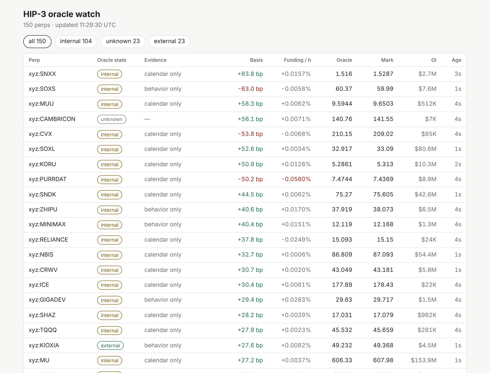

# hip3-oracle-watch

Watches oracle state and mark/oracle dislocations on Hyperliquid HIP-3 equity and
commodity perps. Read-only: it places no orders and holds no keys.

Status: the collector, detector, MCP server, HTTP API, status page and alerts all
exist. The detector has been checked against one evening of data only.

First write-up: [At 20:00 Seoul time, the oracle for Korean stock perps changes
character](docs/posts/2026-11-26-seoul-2000.md).



## Layout

An npm workspaces monorepo.

| Path | Contents |
|---|---|
| `apps/server` | collector, detector, MCP server, HTTP API and the built-in status page |
| `apps/web` | front end (Next.js), consuming the HTTP API |
| `packages/api-types` | response types of the HTTP API, shared by server and front end |

Install once at the root; every command below runs from the root too, so a
relative `--db` path always means the same file.

## Run

Requires Node 22.13 or newer.

```bash
npm install
```

```bash
npm run collect -- --db oracle-watch.db
```

```bash
npm run status -- --db oracle-watch.db --hours 24
```

```bash
npm run compact -- --db oracle-watch.db --retention-days 7 --vacuum
```

```bash
npm run detect -- --db oracle-watch.db --hours 6 --follow
```

```bash
npm run events -- --db oracle-watch.db --hours 24 --kind mode_switch
```

```bash
npm run states -- --db oracle-watch.db
```

```bash
npm run serve -- --db oracle-watch.db --port 8787
```

```bash
npm run session -- xyz:NVDA
```

```bash
npm run alert -- --db oracle-watch.db --config alerts.json
```

The processes share one database file: `collect` writes ticks, `detect --follow`
writes states and events, `serve` and `mcp` read them, and `alert` sends events out.

`collect` polls `metaAndAssetCtxs` for the whole dex every 5 seconds and follows the
40 most traded coins over WebSocket (`activeAssetCtx`). A row is written only when
oracle, mark, mid, funding or open interest changes. `status` reports coverage and
any stretch longer than three poll intervals without a successful poll.

Behind an HTTPS proxy, set `NODE_USE_ENV_PROXY=1` so `fetch` honours `HTTPS_PROXY`.
The WebSocket picks the proxy up on its own.

## Deploy

One container runs everything:

```bash
npm start -- --db /data/oracle-watch.db --host 0.0.0.0
```

`run` starts the collector, the detector, the status page and API, and alerts if
the file named by `--config` exists. It listens on `PORT` when the platform sets
it. Measured at about 110 MB of memory and 2% of one core for 150 perps.

The `Dockerfile` does the same and expects a persistent volume at `/data`. Budget
5 GB: seven days of raw ticks settle near 2.6 GB and one-minute bars add about 1 GB
a month. Without a volume the database is lost on every redeploy.

The HTTP API has no authentication. Keep it private or put it behind a proxy.

## Observed timetable

```bash
npm run schedule -- --db oracle-watch.db --days 7 > timetable.md
```

Builds, from stored history, a table of when each perp's oracle switched between
behaving like an external feed and behaving like internal pricing, and which
regime it showed at each time of day. Switches at the same time of day on
different days are grouped, with a count of the days that back them up.

This is what was observed, not what the calendar says. Slots without conclusive
data are left out, and each row shows what the hand-compiled calendar expected at
that moment so mismatches stand out. `--json` prints the same thing as JSON.

## Oracle state

The API does not say whether the deployer's oracle is following an external market
or its own internal pricing, so `detect` infers it from two kinds of evidence.

- Calendar: whether the underlying market is open, from `apps/server/data/venues.json`.
- Behavior: over the last five minutes, the share of oracle updates that moved
  toward the mark price. Internal pricing creeps toward mark; an external feed
  moves both ways.

| State | Meaning |
|---|---|
| `external` | oracle is following an outside market |
| `internal` | oracle is on the deployer's internal pricing |
| `transition` | within ten minutes of a scheduled open or close, behavior not yet clear |
| `stale` | an external feed is expected but the oracle has not moved for 5 minutes while mark kept moving |
| `unknown` | no venue mapping and too few updates to judge |

Every state carries a confidence: `both` when calendar and behavior agree,
`behavior` when only behavior speaks or it overrules the calendar, `calendar` when
there were too few updates to judge. When the two disagree, behavior wins and the
row is flagged as a conflict, which usually means the calendar is wrong.

| Event | Fires when |
|---|---|
| `mode_switch` | the mode changes and holds for two evaluations |
| `basis_breach` | basis is at least 50 bp and 3 sigma from its baseline for a minute |
| `oracle_jump` | one oracle update moves at least 100 bp |
| `oracle_stale` | the stale state begins |
| `funding_extreme` | hourly funding reaches 0.05% in either direction |
| `oi_cap_near` | open interest reaches 90% of the deployer's cap |
| `calendar_conflict` | calendar and behavior disagree for two evaluations, away from a scheduled open or close |

`detect` replays stored ticks through the same code that runs live, so it can be
rerun over history; rows are keyed so a rerun does not duplicate them. It never
evaluates past the last tick or across a collector outage.

Checked against one live capture so far: on 2026-11-26 the share of SKHX oracle
updates moving toward mark went from about 0.45 to 0.99 at 20:00 Seoul time, and
the replay reported the switch four and a half minutes later. The thresholds and
the Korean evening session in the calendar both come from that same day, so this
is an in-sample check, not a validation.
Treat the output as an inference to be checked, not as a statement by the deployer.

## MCP server

`mcp` speaks the Model Context Protocol over stdio and exposes five read-only tools.

| Tool | Answers |
|---|---|
| `get_oracle_state` | state, evidence, basis, funding and next session change for one perp |
| `list_dislocations` | perps with the widest mark/oracle gap right now |
| `get_events` | recent detector events, filterable by perp and kind |
| `get_basis_history` | basis and funding time series |
| `get_session_calendar` | sessions of the underlying market |

Client configuration, with absolute paths filled in:

```json
{
  "mcpServers": {
    "hip3-oracle-watch": {
      "command": "npx",
      "args": ["tsx", "/path/to/hip3-oracle-watch/apps/server/src/cli.ts", "mcp", "--db", "/path/to/oracle-watch.db"]
    }
  }
}
```

Every answer carries the observation time, the source, units, and a `health` block
saying whether the collector and detector are currently running, so a client can
tell a quiet market from a stopped pipeline.

## Alerts

`alert` sends detector events to webhooks and Telegram. Copy `alerts.example.json`
to `alerts.json` (git-ignored) and edit it. Each sink can be limited to some event
kinds and some perps.

Secrets stay out of the file. A Telegram bot token is read from
`TELEGRAM_BOT_TOKEN`, and a webhook URL that embeds a token can be supplied through
an environment variable named by `urlEnv`.

The webhook body is JSON with `text` and `content` (the same readable summary, so
Slack- and Discord-style endpoints both display it) and `event` (the raw fields).

Delivery is recorded per event per sink. A failed send is retried on the next pass
until the event is 30 minutes old; after that it is marked expired. So a restart
neither repeats nor loses alerts, and replaying old history does not flood a
channel. At most 20 messages go to one sink per ten-second pass.

`--once` runs a single pass and exits.

## HTTP API

`serve` binds to 127.0.0.1 by default and serves the status page at `/`. There is
no authentication; put it behind a reverse proxy before exposing it.

Front-end guide with response shapes and a Next.js example: [docs/api.md](docs/api.md).
Design brief for the front end: [docs/web-design.md](docs/web-design.md).

| Route | Parameters |
|---|---|
| `GET /v1/health` | |
| `GET /v1/coins` | |
| `GET /v1/coin/{coin}` | `hours`, `intervalMinutes` |
| `GET /v1/overview` | |
| `GET /v1/state/{coin}` | |
| `GET /v1/dislocations` | `minBp`, `state`, `limit` |
| `GET /v1/events` | `coin`, `kind`, `hours`, `limit` |
| `GET /v1/basis/{coin}` | `hours`, `intervalMinutes` |
| `GET /v1/calendar/{coin}` | |

## Data

SQLite, one file.

| Table | Contents |
|---|---|
| `ticks` | coin, time, oracle, mark, mid, impact prices, funding, open interest, source |
| `bars_1m` | one-minute bars built from ticks older than the retention window |
| `states` | detector output, one row per change of state, confidence or conflict |
| `events` | detector events |
| `deliveries` | which events have been sent to which alert sink |
| `kv` | detector heartbeat |
| `polls` | one row per successful full poll; coverage is measured here |
| `dex_config` | `perpDexs` entry for the dex, stored when it changes |
| `ws_events` | socket opens and closes |

## Retention

Raw ticks are kept for 7 days (`--retention-days`). Older ticks are folded into
`bars_1m` and deleted. The collector does this at start-up and then hourly;
`compact` does it on demand. Each bar keeps oracle and mark open/high/low/close,
the minimum and maximum basis in basis points, the largest single oracle step, and
closing funding and open interest. Poll records are kept for 90 days.

Measured on a 6.6 million tick backlog: 56 seconds, 690 MB down to 61 MB after
`--vacuum`. Deleting rows does not shrink the file by itself; SQLite reuses the
freed pages, so the file stops growing once it reaches its steady size. Pass
`--vacuum` to hand the space back, and stop the collector first because it
rewrites the whole file.

Rough sizing at 150 coins: about 370 MB per day of raw ticks and up to 33 MB per
day of bars.

## Calendar caveat

`apps/server/data/venues.json` and `symbols.json` beside it are hand-compiled first drafts. Every
venue is marked `verified: false`, non-US holiday lists cover 2026 only, and tickers
whose reference market is not known map to `unknown`. Do not rely on a session
phase until the venue has been checked against the exchange's own calendar.

## Test

```bash
npm test
```

Not investment advice. Oracle state reported by later versions of this tool is an
inference from public data, not a statement from the deployer.
