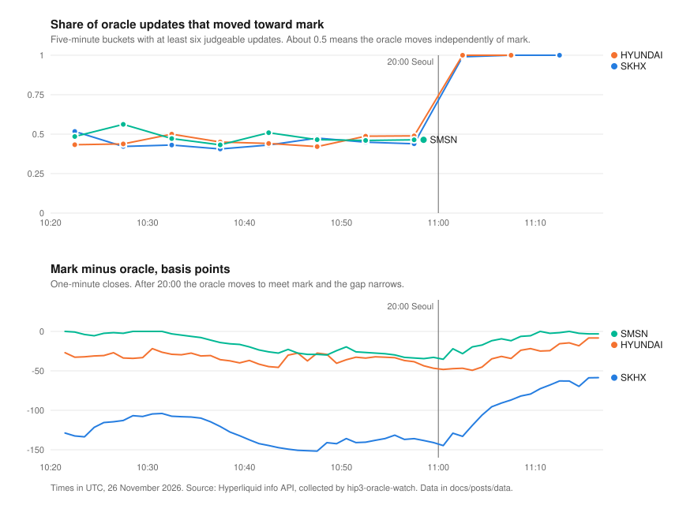

# At 20:00 Seoul time, the oracle for Korean stock perps changes character

*26 November 2026. One evening of data, one venue (xyz on Hyperliquid). Read the limits section before relying on any of it.*

At 11:00 UTC on 26 November, which is 20:00 in Seoul, the oracle price of three Korean single-stock perps on the xyz HIP-3 dex stopped behaving like a feed from an outside market and started moving toward the perp's own mark price. In the following fifteen minutes the gap between mark and oracle on SK hynix (`xyz:SKHX`) narrowed from about 141 basis points to about 70, not because mark moved up but because the oracle moved down to meet it.

The Hyperliquid API reports an oracle price for every perp. It does not report where that price is coming from. This note shows that the change of source can be read off the oracle's own behaviour, and what it looked like on the one evening captured so far.



## What was measured

Every oracle update either moves the oracle toward the current mark price or away from it. Over a window, the share that moves toward mark separates two regimes.

- If the oracle follows an outside market, it moves for reasons that have nothing to do with the perp's order book. About half the updates happen to move toward mark.
- If the oracle is computed from the perp's own prices, it chases mark. Nearly every update moves toward it.

The collector polled all 150 xyz perps every five seconds and followed the 40 most traded over WebSocket from 10:21 to 11:16 UTC, with no gaps. The table gives five-minute buckets on either side of the hour.

| Bucket (UTC) | SKHX updates | SKHX toward mark | HYUNDAI updates | HYUNDAI toward mark | SMSN updates | SMSN toward mark |
|---|---|---|---|---|---|---|
| 10:50 | 69 | 0.45 | 39 | 0.49 | 50 | 0.46 |
| 10:55 | 66 | 0.44 | 45 | 0.49 | 56 | 0.46 |
| 11:00 | 101 | 0.99 | 16 | 1.00 | 5 | 1.00 |
| 11:05 | 101 | 1.00 | 8 | 1.00 | 3 | 1.00 |
| 11:10 | 88 | 1.00 | 4 | 1.00 | 0 | n/a |

For the forty minutes before the hour, all three sat between 0.41 and 0.56. In the first bucket after it, all three were at 0.99 or 1.00.

## What happened to the gap

| Perp | Basis at 10:55 bucket close | Basis at 11:10 bucket close | Hourly funding at 10:55 | Hourly funding at 11:10 |
|---|---|---|---|---|
| SKHX | −140.9 bp | −69.7 bp | −0.081% | −0.059% |
| HYUNDAI | −46.7 bp | −18.2 bp | −0.020% | −0.018% |
| SMSN | −32.9 bp | −2.4 bp | −0.004% | −0.006% |

Basis is mark divided by oracle, minus one. All three perps were trading below their oracle going into the hour, and the gap had been widening on SKHX since about 10:35. After the hour the oracle stepped toward mark on every update.

The three did not converge at the same speed. Samsung Electronics (`xyz:SMSN`) closed its gap in eight oracle updates and then the oracle went quiet. SKHX kept updating about twenty times a minute and still had 70 basis points to go when the capture ended.

## What did not change

Three controls from the same capture, same buckets:

| Perp | Toward mark, 10:55 | Toward mark, 11:05 | Reading |
|---|---|---|---|
| `xyz:KR200` (Korean index) | 0.44 | 0.58 | no change at 20:00 |
| `xyz:GOLD` | 0.43 | 0.47 | no change |
| `xyz:NVDA` | 1.00 | 1.00 | already chasing mark all evening |

The Korean index perp carried on as before, so whatever it references did not stop at 20:00. Gold is a market that was open throughout. Nvidia shows the other regime for the whole capture: 26 November was a US market holiday, and the few oracle updates it had all moved toward mark.

`xyz:SKHY`, the other SK hynix-linked perp, also showed the chasing pattern all evening, before and after 20:00. It does not share SKHX's reference.

## What the detector reported

The detector in this repository classifies each perp every thirty seconds from a five-minute window. Replayed over the capture, it reported:

| Time (UTC) | Perp | Event | Evidence |
|---|---|---|---|
| 11:04:30 | SKHX | external → internal | calendar and behaviour agree |
| 11:05:00 | HYUNDAI | external → internal | calendar and behaviour agree |
| 11:10:30 | SMSN | external → internal | calendar only |

The lag of four and a half minutes is the window: the share only crosses the threshold once most of the window lies after the hour. SMSN was reported later and on weaker evidence because its oracle caught up with mark so quickly that it left too few updates to judge.

## Limits

- **One evening.** Everything here comes from a single 55-minute capture. It has not been checked against another day.
- **The cause is inferred.** The timing is consistent with the oracle following an evening trading session in Seoul that ends at 20:00 and switching to the deployer's internal pricing afterwards. That is an inference from the clock. Nothing in the API confirms the source, and the deployer's own specification was not consulted for this note.
- **The detector was tuned on this capture.** Its thresholds, and the evening session in its calendar, were set from the same data it is shown detecting. This demonstrates that the signal exists and can be picked up, not that the detector generalises.
- **Poll resolution.** Perps outside the top 40 by volume are sampled every five seconds, so several oracle updates inside one interval count as one.
- **A holiday.** US equities were closed all day. Liquidity and positioning on a normal session may look different.

This is a description of public data. It is not investment advice, and it makes no claim about what the oracle should have done.

## Reproduce

The figures above are in `docs/posts/data/`:

- `2026-11-26-toward-mark-5min.csv`: updates, share toward mark, closing basis and funding per five-minute bucket for six perps
- `2026-11-26-basis-1min.csv`: one-minute closing oracle, mark and basis for the three Korean names

To capture another evening:

```bash
npm run collect -- --db oracle-watch.db
```

```bash
npm run detect -- --db oracle-watch.db --hours 2
```
